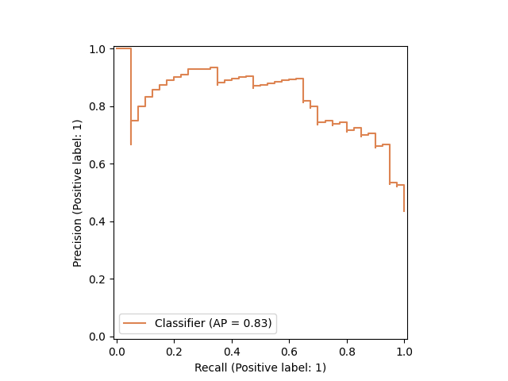
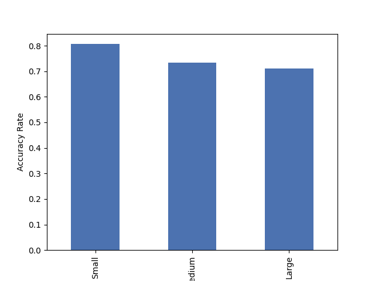

# Evaluating Signal Dilution and Model Efficiency with BiLSTM Models Trained on Whole Phage Proteomes (PhaLSTM)

This repository contains all source code and research data used for our research paper accepted to the IEEE International Conference on Bioinformatics and Biomedicine's (BIBM) 2nd International Workshop on Trustworthy AI for Biomedical Discovery.

